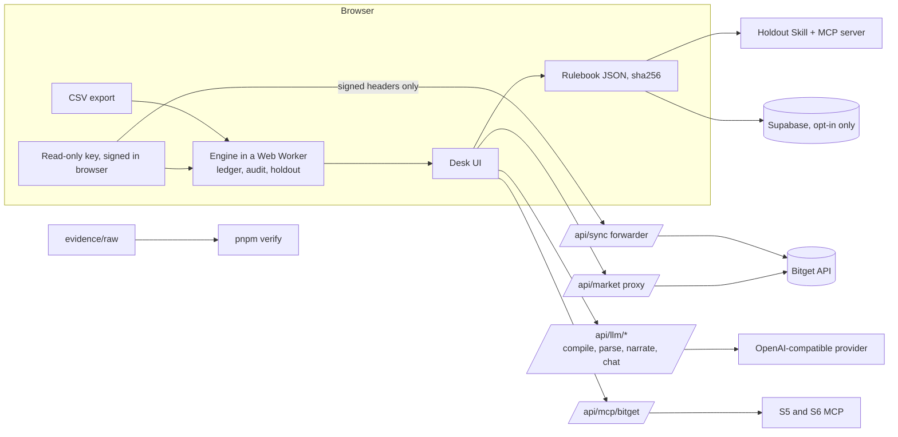

# Holdout

**A trading journal that proves which rules make you money.**

Holdout takes a Bitget trader's own fills, audits the rules they say they follow, tests candidate rules on trades they never saw, keeps a rule only if it beats a same-size random rule, and checks every new trade idea against the result. The trader makes every decision. **Holdout never places orders.**

Built solo for the Bitget AI Base Camp S2 hackathon. Track 3 (AI Trading Desk), sub-theme Review and Self-Evolution.

[](https://github.com/winsznx/holdout/actions/workflows/ci.yml)
[](LICENSE)

- Live app: https://holdout.timjosh507.workers.dev (Cloudflare Workers)
- Evidence page: https://holdout.timjosh507.workers.dev/evidence
- Repository: https://github.com/winsznx/holdout

<!-- evidence:start -->
Evidence is published at https://holdout.timjosh507.workers.dev/evidence once the pre-registered evaluation has run.
<!-- evidence:end -->

## For reviewers: the short version

| Question | Answer |
|---|---|
| What is it? | A review tool. Import fills, state rules, see what breaking each rule cost, see which new rules survive a test on unseen trades, check the next trade. |
| What is the research claim? | A rule chosen on a trader's earlier trades should beat a same-size random rule on their later trades. Holdout tests that claim per trader and publishes the nulls. |
| What does the evidence cover? | Five Bitget Demo bots with one planted habit each, plus a disciplined control. They test detection power and false positives. They are **not** evidence about human traders. |
| Where do the numbers come from? | The engine, on real fills read back from the Bitget API. No mocks, no placeholder data. Every published number is recomputed by `pnpm verify` with no network and no keys. |
| What does the LLM do? | Compiles plain-language rules into a typed DSL (and refuses what it cannot test), parses trade ideas, narrates engine results through a numbers firewall, and runs the desk chat through tools. It never computes a number and never sees raw fills. |
| Does it trade? | No. Only `harness/` places orders, on Bitget Demo only, as test subjects. It is not part of the product. |

## What it does

1. **Import.** Read-only Bitget key (signed in your browser) or CSV (parsed in your browser, never uploaded).
2. **Ledger.** Fills are deduped on `execId`, grouped into round trips, and reconciled against Bitget's own positions history. A ledger that does not reconcile (total delta above 1%, any symbol above 2%) blocks proposals and says why.
3. **Say your rules.** Plain words in, one of eight typed templates out, shown back in canonical English for you to confirm. Untestable rules ("only trade when confident") are refused.
4. **Audit.** For each stated rule: how many times you broke it, which trades (by exec id), what breaking it cost, and a 90% bootstrap interval. Under 5 breaks it says "not enough breaks to price".
5. **Proposals.** Candidate rules are selected on the first two thirds of your history and tested on the last third against a 1,000-draw random sham and a GetAgent-style baseline. The selection function receives only train trades, so it cannot see the test period.
6. **Session lens.** P&L by US session, holds across the open and the weekend, stock perp versus rToken, funding and premium cost.
7. **Check a trade.** "long NVDA 20x now" becomes one card: rules it breaks, your record on similar trades, session state now, earnings state, signal tags. You decide.
8. **Skill and MCP.** The same check runs inside Claude Code, Codex, OpenClaw and Cursor before an order preview.

## How this maps to the Track 3 criteria

| Criterion | Where to look |
|---|---|
| Feature depth: data sources | Eight surfaces, each used in a code path that changes a number or a verdict (table below). Unavailable sources are named and their dependents marked untestable. |
| Feature depth: Skill integration | `packages/skill` (Skill + MCP server), plus the bitget-mcp-server (S5) and bitget-signal (S6) clients in `packages/bitget`. |
| Research quality | Pre-registration (`evidence/PREREG.md`) committed before any test-period read, a freeze gate in `scripts/eval.ts`, a sham test, a baseline, eight lemmas with property tests, a published kill rule, and nulls on the evidence page. |
| LUI fluency | `/desk/chat` and the chat drawer on every desk route: tool-calling assistant that answers with engine cards, with a numbers firewall on its text. `/desk/check` parses free-text trade ideas and asks a clarifying question instead of guessing. |
| Personalized thesis | The rulebook is built from one trader's own fills and stated rules, exported as signed JSON, and consumed by the Skill. |

## Bitget and partner surfaces

| # | Surface | Used for | Status |
|---|---|---|---|
| S1 | Bitget fills (UTA v3 `GET /api/v3/trade/fills`, CSV export) | Core ledger | Live, verified on Demo |
| S2 | Positions history and financial records | Independent readback that reconciles the ledger, funding | Live, verified on Demo. No funding row observed (Demo holds are minutes) |
| S3 | Mark, index, premium candles and funding history | Hard stop replay, leverage check, funding cost | Live |
| S4 | rToken spot candles (`rTICKERUSDT`) | Product-switch counterfactual | Not available on Demo. Rule is untestable on Demo data |
| S5 | bitget-mcp-server (`agent.bitget.com/mcp`) | Earnings calendar, quotes, fundamentals | Earnings and quotes work. K-lines return empty |
| S6 | bitget-signal | Live market-state tags on the check card | Only technical analysis and crypto derivatives return data |
| S7 | NYSE 2026 calendar (`packages/engine/src/data/nyse-2026.json`, source URL inside) | Session tag per fill, as of trade time | Live |
| S8 | Chainbase AgentKey | News and social context on the check card | Not connected (needs a paid console key). The card says "context unavailable (S8)" |

Findings about these surfaces are in [docs/SPONSOR_FINDINGS.md](docs/SPONSOR_FINDINGS.md) and the Day-0 probes in [docs/DAY0.md](docs/DAY0.md).

## Architecture



The engine (`packages/engine`) is pure TypeScript with no I/O. The same code runs in the browser, in the evaluation scripts and in the verifier, which is why the evidence can be recomputed offline.

## The rule language

Eight pre-registered templates, each with an optional scope (symbols, products, sides).

| Template | Counterfactual |
|---|---|
| `cooldown_after_loss` | Trades opened too soon after a loss are removed |
| `max_leverage` | Size scales by cap divided by actual leverage |
| `no_add_to_loser` | Only the lots added while losing are removed |
| `hard_stop` | Replay mark candles, exit at the worst price in the bar that hits the stop, plus a taker fee |
| `daily_loss_limit` | Trades opened after the day's realized loss hit the limit are removed |
| `session_filter` | Trades opened in blocked sessions are removed |
| `earnings_blackout` | Trades opened within N hours before earnings are removed |
| `product_switch_weekend` | Weekend or overnight stock perp exposure is replaced by 1x rToken spot |

Exact semantics, assumptions and the sign convention are in [docs/METHODOLOGY.md](docs/METHODOLOGY.md).

## Evaluation design

| Case | What it checks |
|---|---|
| P1, P1b | Each leaky bot's audit prices its own planted habit. A 5x4 matrix of bot against rule reports precision and recall. |
| P2 | The disciplined control gets "no rule needed". |
| P3 | Under 30 trades: audit runs, proposals say "not enough trades". |
| P4 | A labeled copy of real history with injected post-loss re-entries. Recall and cost error against ground truth. Never presented as real. |
| P5 | A removed funding window flags the ledger incomplete and blocks proposals. Reported as not testable if no trade crossed a funding settlement. |
| P6 | Merging API fills with a CSV rendering of the same fills leaves the ledger byte-identical. The CSV is rendered from API fills, not a live export. |
| P7 | Ablation: rerun with S3, S4, S5 and S7 off. Counts rules that become untestable and the audited dollars that vanish. |
| P8 | Every trader goes through the same frozen pipeline. Failures are published. |
| P9 | Rule compiler accuracy on rules written by other people, scored against hand labels made before the run. Reports n, however small. |

Cohorts are never merged: Bitget Demo bots, strategy samples and any human histories are separate tables.

## Honest limits

- Demo bots are test subjects for the method, not human traders. No claim that Holdout improves real traders is made unless the pre-registered test passes on human data.
- The Bitget CSV adapter was built to documented columns and is untested against a live export. The UI says so.
- The `money_boys` files are a friend's strategy backtest and paper ledger with day-level timestamps. They are labeled "Strategy sample, not live fills" and cannot exercise intraday, session, leverage or hard-stop rules.
- Bitget fill history has no leverage. For the bots it is read from the client order id they set. For a real export the max-leverage rule is untestable.
- Bitget Demo allows one demo deposit per 72 hours, so the bot fleet runs on about 414 USDT with 20 USDT lots. The bots' timing was compressed to collect enough trades (see [docs/DECISIONS.md](docs/DECISIONS.md)).
- Chainbase AgentKey (S8) is not connected.

Every deviation from the original plan is dated in [docs/DECISIONS.md](docs/DECISIONS.md).

## The numbers firewall

After narration, a validator extracts every digit run from LLM text. Any digit that did not come from an engine-filled slot fails the message and falls back to a deterministic template. Failures are counted and shown on the evidence page. The LLM only receives rule text, the DSL schema, aggregates and tool results, never raw fills and never keys.

## Privacy and key handling

- CSV is parsed in a Web Worker and never sent anywhere.
- For API sync the browser computes the HMAC signature with WebCrypto. `/api/sync` receives only the method, path, query and the four ACCESS headers, forwards the exact request to Bitget, streams the answer back, logs nothing and stores nothing. The key and passphrase pass through the edge function in memory.
- `/api/sync` only forwards GET requests to an allowlist of read endpoints. Anything else, including any trade path, is refused.
- Engine state lives in IndexedDB in your browser. "Delete my data" clears it.
- Supabase stores only opt-in saved rulebooks and per-rule aggregates, under row-level security on an anonymous device id. No fills.

See `/privacy` in the app.

## Holdout Skill and MCP server

```
node packages/skill/dist/stdio.js          # stdio MCP server
export HOLDOUT_RULEBOOK=/path/to/rulebook.json
```

Tools, all read-only: `get_rulebook`, `check_trade`, `explain_rule`. The HTTP version is served at `/api/mcp`. `packages/skill/SKILL.md` tells an agent to call `check_trade` before any `bgc` order preview, show the card, and wait for the human. Install steps for Claude Code, Codex, OpenClaw and Cursor are in `packages/skill/README.md` and at `/skill`.

## Routes

| Route | Purpose |
|---|---|
| `/` | Landing |
| `/sample` | One-click labeled history, no account |
| `/desk`, `/desk/import`, `/desk/ledger` | Import, round trips, reconciliation |
| `/desk/rules`, `/desk/proposals`, `/desk/sessions` | Rules on trial, holdout proposals, session lens |
| `/desk/check`, `/desk/chat`, `/desk/rulebook` | Check a trade, chat, versions and export |
| `/evidence`, `/evidence/[traderId]` | Proof surface |
| `/methodology`, `/skill`, `/privacy` | Method, install, data flow |

API routes: `/api/market/*`, `/api/sync`, `/api/mcp/bitget`, `/api/llm/{compile,parse-idea,narrate,chat}`, `/api/mcp`, `/api/rulebooks`.

## Repository layout

| Path | What it is |
|---|---|
| `apps/web` | Next.js app on Cloudflare Workers (OpenNext) |
| `packages/engine` | Pure TypeScript: ledger, round trips, sessions, rules, replay, holdout, stats, rulebook |
| `packages/bitget` | Typed UTA v3 clients, signing, S5 and S6 MCP clients |
| `packages/llm` | Rule compiler, idea parser, narrator, numbers firewall, chat |
| `packages/skill` | Holdout Agent Skill and MCP server |
| `harness` | Test-subject bots that trade on Bitget Demo only |
| `scripts` | `eval.ts`, `verify.ts`, history and market export, rulebook build, submission generator |
| `evidence` | `PREREG.md`, raw data, freeze files, runs |
| `docs` | Methodology, math, decisions, Day-0, sponsor findings, claim ledger |
| `supabase` | Migration for the opt-in tables |

## Run it locally

Requires Node 24 and pnpm 11.

```
pnpm install
pnpm typecheck
pnpm test
pnpm --filter @holdout/web dev
```

Copy `.env.example` to `.env` and `harness/.env.example` to `harness/.env`. Real keys are git-ignored.

| Variable | Used by |
|---|---|
| `LLM_API_KEY`, `LLM_BASE_URL`, `LLM_MODEL` | `packages/llm` (any OpenAI-compatible provider) |
| `QWEN_API_KEY`, `QWEN_BASE_URL`, `QWEN_MODEL` | Optional Qwen path, config only |
| `BITGET_READONLY_KEY`, `_SECRET`, `_PASSPHRASE` | Optional sync check, never used by the harness |
| `SUPABASE_URL`, `SUPABASE_ANON_KEY` | Opt-in rulebook storage |
| `BITGET_DEMO_KEY`, `_SECRET`, `_PASSPHRASE` | `harness/.env` only, Demo orders |

## Verify the evidence

```
pnpm verify
```

Recomputes every number on the evidence page from `evidence/raw` with no network and no keys, compares it to the published run, and prints PASS or FAIL per number. It then runs a tamper test that changes one digit in one fill and must fail.

The evaluation itself is two commands with a git gate between them: `scripts/eval.ts select` writes `evidence/freeze/<trader>.json`, and `scripts/eval.ts test` refuses to run unless `evidence/PREREG.md` and every freeze file are committed.

## Tests

Property-based tests (fast-check, 1,000 runs each) cover the lemmas: L1 ledger conservation, L2 idempotent ingest, L3 null rule identity, L4 removal decomposition, L5 sham p-value validity, L6 no look-ahead, L7 bootstrap coverage, L8 selection blindness. See [docs/MATH.md](docs/MATH.md). Current totals: engine 18, bitget 36, llm 20, skill 25, web 77.

## Documents

[docs/README.md](docs/README.md) indexes the docs. For the idea in one page read [docs/THESIS.md](docs/THESIS.md). For how each claim is backed read [docs/CLAIM_LEDGER.md](docs/CLAIM_LEDGER.md). For the system diagram and data flow read [docs/ARCHITECTURE.md](docs/ARCHITECTURE.md).

## License

MIT. See [LICENSE](LICENSE).
