# Architecture

## Principles
1. The engine computes every number. It is pure TypeScript with no I/O.
2. The LLM never computes, never sees raw fills, and any digit in its text must come from an engine-filled slot.
3. Holdout never places orders. Only `harness/` does, on Bitget Demo.
4. No silent fallback. A missing Bitget surface is named and its dependent rules are marked untestable.
5. Private data stays in the browser. CSV is parsed locally. API sync is signed locally.

## Data flow

```mermaid
flowchart TB
  A[Fills: CSV or read-only key] --> B[Dedupe on execId]
  B --> C[Round trips: one position episode per symbol and side]
  C --> D[Reconcile against positions history]
  D -->|pass| E[Session and product tags as of trade time]
  D -->|fail| X[Proposals blocked, reason shown]
  E --> F[Audit stated rules with bootstrap interval]
  E --> G[Holdout: split, select on train, freeze, test, sham, baseline]
  F --> H[Rulebook JSON with sha256]
  G --> H
  H --> I[Desk UI]
  H --> J[Skill and MCP: check_trade]
  H --> K[Evidence bundle and pnpm verify]
```

## Packages
- `packages/engine`: `ingest`, `roundtrips`, `reconcile`, `sessions`, `rules/{schema,render,counterfactual,audit,holdout}`, `rulebook`, `stats`, `csv`, `checks`.
- `packages/bitget`: signing (WebCrypto), public and private clients, normalizers, MCP clients for S5 and S6.
- `packages/llm`: provider, compiler, idea parser, narrator, firewall, chat loop.
- `packages/skill`: MCP server over stdio and HTTP, `SKILL.md`.
- `apps/web`: UI and API routes. The engine runs in a Web Worker.
- `harness`: five test bots with one planted habit each, plus a disciplined control. Demo only.

## Evaluation pipeline
`scripts/export-histories.ts` reads fills back from the Bitget Demo API and writes `evidence/raw/histories/*.json`. `scripts/eval.ts select` freezes one rule per trader. After the freeze files are committed, `scripts/eval.ts test` runs the test step and writes `evidence/runs/<runId>`. `scripts/verify.ts` recomputes the run offline.

## Deployment
Cloudflare Workers through `@opennextjs/cloudflare`. Secrets (LLM key, Supabase anon key) are Worker secrets. The Supabase tables `saved_rulebooks` and `cohort_rule_aggregates` use row-level security keyed on an `x-device-id` header.
